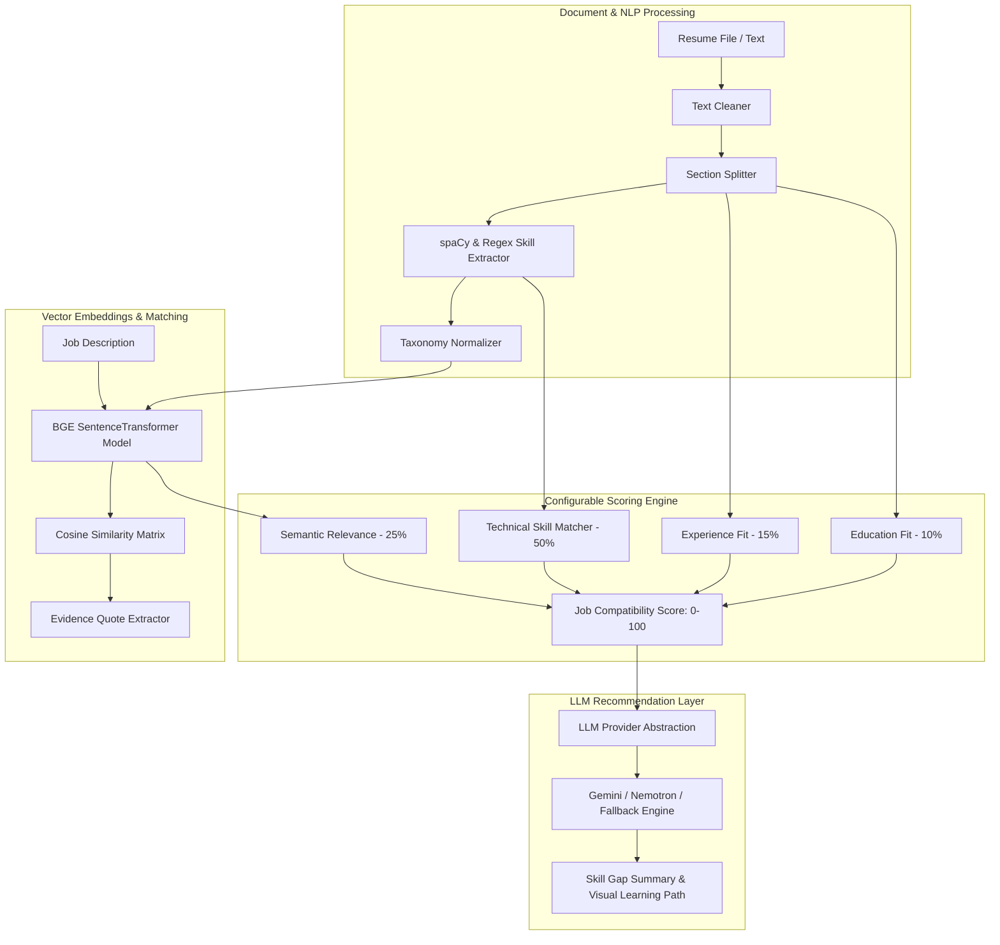

# JobFit AI — Semantic Resume–Job Matching & Skill Gap Analyzer

**JobFit AI** is an enterprise-grade AI/ML web application designed to evaluate candidate resume compatibility against target job descriptions. Rather than relying on simple keyword matching or pure LLM prompting, JobFit AI executes a modular multi-stage NLP & Transformer Embedding Machine Learning Pipeline.

---

## 1. Core Architecture & ML Pipeline

JobFit AI follows a strict decoupled architecture where ML logic, NLP processing, embedding generation, scoring engine calculations, and database persistence remain isolated from the API router and frontend presentation layers.



---

## 2. Key Features

- **Multi-Format Text Extraction**: Extract text cleanly from PDF (`PyMuPDF`), DOCX (`python-docx`), or plain text files.
- **NLP Section Segmentation**: Automatically segments resumes into Summary, Education, Skills, Work Experience, Projects, and Certifications.
- **Skills Taxonomy & Normalization**: Normalizes raw skill variations (e.g. `ML` / `Machine Learning`, `Postgres` / `PostgreSQL`, `FastAPI` / `REST APIs`) against a configurable JSON taxonomy.
- **Transformer Embeddings**: Uses `BAAI/bge-small-en-v1.5` to project text sections and skill phrases into dense 384-dimensional vector embeddings.
- **Cosine Similarity & Evidence Extraction**: Computes exact cosine similarity between candidate experience chunks and job requirements, extracting literal supporting quotes from the resume text.
- **Configurable Scoring Engine**: Calculates job compatibility (0–100) using weighted sub-components:
  - Technical Skills Match: **50%**
  - Semantic Relevance: **25%**
  - Experience Relevance: **15%**
  - Education/Qualification Match: **10%**
- **LLM Provider Abstraction**: Generates prioritized skill gap summaries, visual learning path roadmaps, and suggested portfolio projects via Gemini API, NVIDIA Nemotron, or a deterministic offline fallback engine.
- **PostgreSQL & pgvector Integration**: Stores uploaded resume metadata, analysis results, and skill vectors, with automatic fallback to local SQLite for seamless offline dev.
- **Modern AI SaaS Frontend**: React + Vite + Recharts interface featuring score dials, interactive tabbed skill badges, Recharts skill gap charts, and evidence cards.
- **1-Click Demo Mode**: Built-in sample datasets for Machine Learning Engineer, Backend Developer, and Data Analyst that process live through the ML pipeline.

---

## 3. Technology Stack

- **Frontend**: React 18, Vite, Recharts, Lucide Icons, Modern CSS Dark Slate Design System.
- **Backend**: Python 3.11+, FastAPI, Pydantic v2, SQLAlchemy 2.0.
- **ML / NLP**: PyTorch, Hugging Face Transformers, SentenceTransformers (`BAAI/bge-small-en-v1.5`), spaCy, scikit-learn, NumPy, Pandas.
- **Document Parsing**: PyMuPDF (`fitz`), `python-docx`.
- **Database**: PostgreSQL with `pgvector` (SQLite local fallback).
- **LLM**: Gemini API, NVIDIA Nemotron, Offline Rule Fallback.
- **DevOps**: Docker, Docker Compose, pytest.

---

## 4. Installation & Local Setup

### Prerequisites
- Python 3.10+
- Node.js v18+ & npm
- Docker (optional)

### Step 1: Clone Repository
```bash
git clone https://github.com/aryanshnigam/JobFit-AI.git
cd JobFit-AI
```

### Step 2: Backend Setup
```bash
cd backend
python3 -m venv venv
source venv/bin/activate
pip install -r requirements.txt
```

### Step 3: Run Backend Tests
```bash
PYTHONPATH=. pytest tests/ -v
```

### Step 4: Start FastAPI Backend
```bash
uvicorn app.main:app --reload --port 8000
```
Backend API will be live at `http://localhost:8000` (Docs: `http://localhost:8000/docs`).

### Step 5: Frontend Setup & Run
In a new terminal window:
```bash
cd frontend
npm install
npm run dev
```
Open `http://localhost:5173` in your browser.

---

## 5. Docker Setup

To run the entire stack (PostgreSQL with `pgvector`, FastAPI backend, and React/Nginx frontend) using Docker Compose:

```bash
docker-compose up --build
```

Access the application at:
- **Frontend UI**: `http://localhost:3000`
- **Backend API Docs**: `http://localhost:8000/docs`

---

## 6. Scoring Methodology

The compatibility score ($S$) is calculated as a weighted sum of four sub-components:

$$S = w_{\text{tech}} \cdot S_{\text{tech}} + w_{\text{sem}} \cdot S_{\text{sem}} + w_{\text{exp}} \cdot S_{\text{exp}} + w_{\text{edu}} \cdot S_{\text{edu}}$$

Where:
- $w_{\text{tech}} = 0.50$, $w_{\text{sem}} = 0.25$, $w_{\text{exp}} = 0.15$, $w_{\text{edu}} = 0.10$
- $S_{\text{tech}}$: Tech skill match ratio calculated via exact taxonomy alias matching (1.0) and high semantic embedding similarity ($\ge 0.78$ matched, $0.55 - 0.78$ partial).
- $S_{\text{sem}}$: Cosine similarity of candidate resume text vector $\vec{R}$ and job description vector $\vec{J}$:
  $$\text{sim}(\vec{R}, \vec{J}) = \frac{\vec{R} \cdot \vec{J}}{\|\vec{R}\| \|\vec{J}\|}$$
- $S_{\text{exp}}$: Cosine similarity between candidate experience section vector and job vector.
- $S_{\text{edu}}$: Keyword matching and semantic alignment of education section.

*Note: The score is a project-defined matching metric and is explicitly not presented as a hiring probability.*

---

## 7. API Reference

- `POST /api/v1/resumes/upload`: Parse uploaded PDF/DOCX/TXT resume.
- `POST /api/v1/jobs`: Parse and extract skills from job description text.
- `POST /api/v1/analyze`: Execute full ML pipeline on resume + job text.
- `POST /api/v1/demo/load`: Load sample profile (`ml_engineer`, `backend_developer`, `data_analyst`) through ML pipeline.
- `GET /api/v1/analyses`: List saved historical analysis runs.
- `GET /api/v1/analyses/{id}`: Retrieve detailed analysis payload by ID.
- `GET /api/v1/health`: Pipeline health check.

---

## 8. Limitations & Future Improvements

- **Current Limitations**: Initial embedding model uses CPU inference; spaCy model falls back to blank model if `en_core_web_sm` is missing.
- **Future Enhancements**: GPU batch inference support, fine-tuned domain BERT models for specialized industry taxonomies, ATS formatting analysis, PDF visual export of learning roadmaps.
